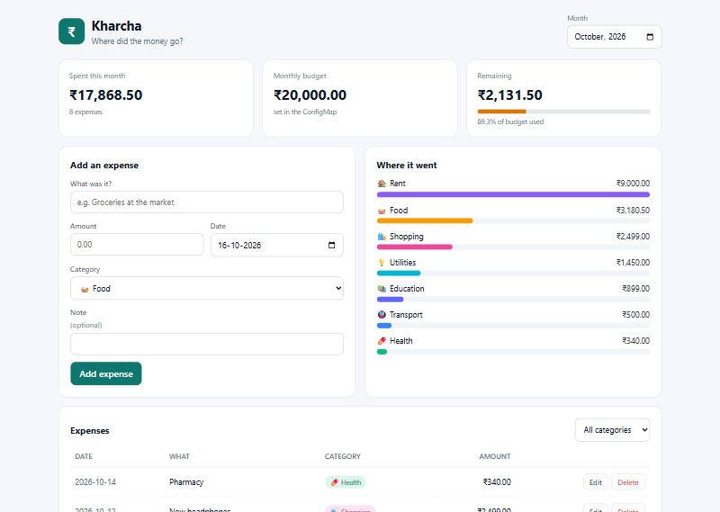
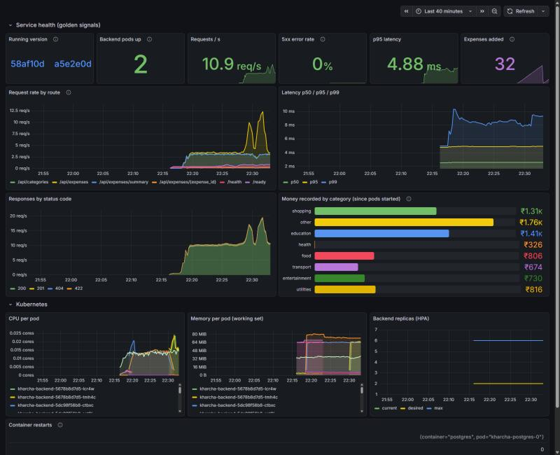
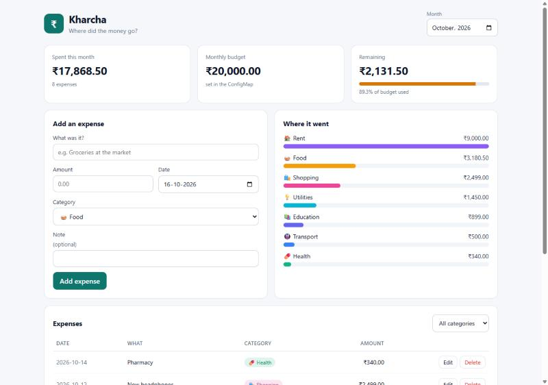
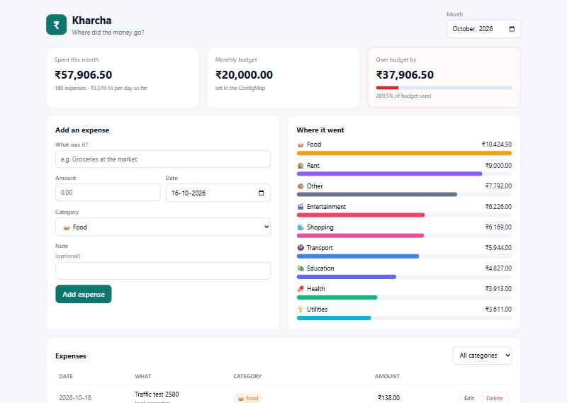

# Kharcha: an expense tracker, shipped the DevOps way

**Kharcha** (खर्चा, Hindi for "expense") answers one question: *where did the money go this month?* You log what you spend, it groups it by category, and it tells you how much of your monthly budget is gone, how much is left, and your spending pace per day.

That is the application. The project is everything around it: tests that gate every change, hardened containers, a Helm chart, a CI/CD pipeline with a security gate, Terraform for AWS, Prometheus and Grafana, and GitOps with ArgoCD. All of it ran for real on my laptop (WSL2 + Minikube) and on GitHub Actions. Every number and every screenshot on this page comes from those runs.



**Live pipeline:** [Actions › Final Project - Kharcha CI/CD](https://github.com/LAVYA255/devops-heros/actions/workflows/final-project.yml) · **Images:** [kharcha-backend](https://github.com/users/LAVYA255/packages/container/package/kharcha-backend), [kharcha-frontend](https://github.com/users/LAVYA255/packages/container/package/kharcha-frontend) on GHCR

> **One honest caveat up front.** The AWS part ran against **LocalStack** (an AWS emulator), not a real AWS account; I have no paid account and no credentials were used anywhere. The VPC applies for real there. EKS cannot, because LocalStack's free edition has no EKS API, and the [Terraform README](terraform/README.md) shows that failure and gives the exact commands for a real account. Everything Kubernetes ran on Minikube, plus a fresh kind cluster in every CI run.

## Contents

- [Where each rubric module lives](#where-each-rubric-module-lives)
- [Architecture](#architecture)
- [Technologies](#technologies)
- [The application](#the-application)
- [Docker](#docker)
- [Kubernetes](#kubernetes)
- [Helm](#helm)
- [Terraform](#terraform)
- [CI/CD](#cicd)
- [DevSecOps](#devsecops)
- [Monitoring](#monitoring)
- [GitOps](#gitops)
- [Troubleshooting](#troubleshooting)
- [Screenshots](#screenshots)
- [Lessons learned](#lessons-learned)

## Where each rubric module lives

| Module | Where | Evidence |
| --- | --- | --- |
| M1 Application | [`application/backend/app/`](application/backend/app), [`application/frontend/src/`](application/frontend/src), [`alembic/versions/`](application/backend/alembic/versions) | `screenshots/01-app-over-budget.jpg`, `02-app-under-budget.jpg` (Compose, localhost:3000) |
| M2 Testing | [`application/backend/tests/`](application/backend/tests), [`pytest.ini`](application/backend/pytest.ini), [`conftest.py`](application/backend/tests/conftest.py) | `terminal/01-pytest-coverage.png`: 33 tests, 100% coverage |
| M3 Git | this repo, [`.gitignore`](.gitignore) | `terminal/36-git-history.png` |
| M4 Docker | [`application/*/Dockerfile`](application/backend/Dockerfile), [`docker-compose.yml`](docker-compose.yml), [`docker/`](docker) | `terminal/02-compose-up.png`, `04-nonroot-images.png` |
| M5 CI/CD | [`.github/workflows/final-project.yml`](../.github/workflows/final-project.yml) (copy in [`.github/`](.github/workflows/final-project.yml)) | [run 38935423932](https://github.com/LAVYA255/devops-heros/actions/runs/38935423932), `screenshots/10-github-actions-run.jpg`, `11-ghcr-package.jpg` |
| M6 DevSecOps | [`security/`](security), Trivy steps in the workflow | `terminal/37-ci-trivy-gate.png`, `15-image-scan-trivy.png` |
| M7 Terraform | [`terraform/`](terraform) | `terminal/17` to `20-terraform-*.png` (LocalStack, see caveat) |
| M8 Kubernetes + Helm | [`kubernetes/`](kubernetes) (the rubric's `k8s/`), [`helm/kharcha/`](helm/kharcha) | `terminal/07-helm-install.png`, `35-final-cluster-state.png`, `09-ingress-routing.png` |
| M9 Observability | [`monitoring/`](monitoring), `/metrics` in [`metrics.py`](application/backend/app/metrics.py) | `terminal/34-metrics-endpoint.png`, `screenshots/07-prometheus-targets.jpg`, `09-grafana-dashboard.jpg` |
| M10 Docs + demo | this file, [`gitops/README.md`](gitops/README.md#the-live-demo-one-commit-to-running-pods) | `terminal/31-gitops-demo.png`, `screenshots/04` to `06-demo-*.jpg` |

The folder layout follows the Session 21 assignment (`application/ docker/ kubernetes/ helm/ terraform/ .github/workflows/ security/ monitoring/ gitops/`), plus `troubleshooting/` and `screenshots/`.

## Architecture

```text
                        ┌──────────────────────────── GitHub ─────────────────────────────┐
  git push ───────────► │ Actions: test ─ scan ─ build ─ Trivy ─ SECURITY GATE ─ push ──┐ │
                        │          (pytest, migrations, npm audit, bandit, pip-audit,   │ │
                        │           gitleaks, helm lint, trivy config)                  │ │
                        │                                     GHCR ◄── :<commit sha> ───┘ │
                        │          deploy to kind + smoke test ─► commit new tag to gitops/│
                        └───────────────────────────────────────────────┬─────────────────┘
                                                                        │ ArgoCD pulls (every 3 min)
 ┌───────────────────────── Minikube (WSL2) ─────────────────────────────▼───────────────────┐
 │  ingress-nginx ──► /        ──► frontend Service ──► nginx pods (x2, uid 101) ── /api ──┐ │
 │  kharcha.local     /api     ──► backend Service ──► FastAPI pods (x2-6 HPA, uid 10001) ◄┘ │
 │                    /health                             │  init container: alembic       │
 │                                                        ▼  migrate (advisory lock)        │
 │  namespace kharcha: PSS "restricted", quota      Postgres StatefulSet + 1 Gi PVC (uid 70)│
 │  monitoring: Prometheus ── scrapes /metrics (pod annotations) ──► Grafana dashboard      │
 │  argocd: Application "kharcha" (auto-sync, prune, self-heal)                             │
 └──────────────────────────────────────────────────────────────────────────────────────────┘
 Terraform (terraform/): VPC, 2 public + 2 private subnets, NAT, EKS + node group (AWS / LocalStack)
```

The browser only ever talks to nginx. nginx serves the React build and proxies `/api` to the backend Service, so there is no CORS and the API is never exposed directly. The backend is stateless (two or more replicas behind a Service) and all state lives in Postgres.

## Technologies

| Layer | Choice |
| --- | --- |
| Backend | Python 3.12, FastAPI 0.143, SQLAlchemy 2.1, Alembic, Pydantic v2, psycopg 3, prometheus_client |
| Frontend | React 19, Vite 8, served by nginx-unprivileged 1.29 |
| Database | PostgreSQL 16 |
| Tests and quality | pytest 9, pytest-cov, flake8, httpx2 TestClient, in-memory SQLite |
| Containers | Docker multi-stage builds, Docker Compose |
| Orchestration | Kubernetes 1.37 (Minikube; kind in CI), Helm 3.16, ingress-nginx 1.15.1 |
| CI/CD | GitHub Actions, GHCR |
| Security | Trivy 0.75, bandit, pip-audit, npm audit, gitleaks, Pod Security Standards |
| IaC | Terraform 1.9.8, AWS provider 5.100, LocalStack 3.8 |
| Observability | Prometheus 3.15, Grafana 12.3, kube-state-metrics, node-exporter |
| GitOps | ArgoCD 3.5 |

## The application

**Backend** ([`application/backend/`](application/backend)):

| Method | Path | What |
| --- | --- | --- |
| GET | `/api/expenses?month=YYYY-MM&category=&limit=` | list, filtered |
| POST | `/api/expenses` | create (201) |
| GET | `/api/expenses/{id}` | one (404 if missing) |
| PUT | `/api/expenses/{id}` | update |
| DELETE | `/api/expenses/{id}` | delete (204) |
| GET | `/api/expenses/summary?month=YYYY-MM` | total, count, budget used %, remaining, per-category totals |
| GET | `/api/categories` | the allowed categories |
| GET | `/health` | liveness: process is up (deliberately does **not** touch the DB) |
| GET | `/ready` | readiness: DB reachable, 503 otherwise |
| GET | `/metrics` | Prometheus metrics |

Details worth knowing:

- **Money is `Decimal`**, stored as `NUMERIC(12,2)` and returned as strings with two decimals (`"1591.50"`), never floats. The first version returned `"20000.0"` and `"1591.5"`; the summary now quantizes everything.
- **Validation** in Pydantic (amount > 0, known category, non-blank title) **and** in the database (`CHECK (amount > 0)`), so a bad row cannot get in even around the API. CI proves the database constraint fires.
- **Month filters** use a half-open range (`>= first day, < first day of next month`), which is correct for every month length and uses the index on `spent_on`.
- **Liveness vs readiness.** If Postgres blips, readiness takes pods out of the Service; liveness stays green so Kubernetes does not restart every API pod and make things worse. A test checks both at once.
- **Migrations** run in a Kubernetes init container before each pod starts. `alembic/env.py` takes a Postgres advisory lock, so when two pods start together one migrates and the other waits and then finds nothing to do (`terminal/08-migrations-advisory-lock.png`).
- **The budget** (`MONTHLY_BUDGET`) and currency come from a ConfigMap: changing the budget is a config change, not a code change.

**Frontend** ([`application/frontend/`](application/frontend)): one page. Summary cards (spent with daily pace, budget, remaining with a meter that turns amber at 80% and red when over), an add/edit form, per-category bars, and a filterable table with edit and delete. The footer shows which API version is serving, which is how you see a deploy land.

**Run it locally:**

```bash
cd final-devops-project
docker compose up --build        # http://localhost:3000
```

**Tests:** 33 tests, 100% line coverage, on an in-memory SQLite database (never a real one), with a dependency override and a fresh schema per test. They cover all CRUD routes, validation, month filtering, the summary maths, the metrics labels, the readiness failure path and the database wait loop. CI fails under 90% coverage.

```text
flake8: clean
TOTAL               218      0   100%
Required test coverage of 90% reached. Total coverage: 100.00%
33 passed in 0.99s
```

## Docker

Full write-up: [`docker/README.md`](docker/README.md).

| | backend | frontend |
| --- | --- | --- |
| build | 2 stages (wheels, then slim runtime) | 2 stages (Node/Vite build, then nginx) |
| runs as | uid 10001 | uid 101 |
| size | 347 MB | 112 MB, no Node inside |
| Trivy | 0 fixable HIGH/CRITICAL | 0 vulnerabilities at any severity |

`docker compose up --build` starts Postgres, backend and frontend with real healthchecks and `depends_on: condition: service_healthy`, so nothing starts before what it needs. A dev override ([`docker/compose.dev.yml`](docker/compose.dev.yml)) mounts the backend source and hot-reloads.

## Kubernetes

[`kubernetes/`](kubernetes) holds what is applied **once**, before the app:

| File | What |
| --- | --- |
| [`namespace.yaml`](kubernetes/namespace.yaml) | namespace `kharcha` enforcing the **restricted** Pod Security Standard: a pod asking for root is refused at admission |
| [`resource-guardrails.yaml`](kubernetes/resource-guardrails.yaml) | ResourceQuota (4 CPU / 4 Gi requests, 40 pods) and LimitRange defaults |
| [`create-db-secret.sh`](kubernetes/create-db-secret.sh) | generates the DB password **inside the cluster**, only if missing, never printed |
| [`tune-ingress-nginx.sh`](kubernetes/tune-ingress-nginx.sh) | caps ingress-nginx at 4 workers (the fix for a real outage, troubleshooting #7) |
| [`kind-ci.yaml`](kubernetes/kind-ci.yaml) | the throwaway cluster CI deploys to |

Final state, all deployed by ArgoCD from git (`terminal/35-final-cluster-state.png`):

```text
NAME                               READY  STATUS   RESTARTS
kharcha-backend-67b98c589d-kmhmg   1/1    Running  0
kharcha-backend-67b98c589d-ncq9b   1/1    Running  0
kharcha-frontend-75f8d65c7d-7wbbf  1/1    Running  0
kharcha-frontend-75f8d65c7d-x2vp9  1/1    Running  0
kharcha-postgres-0                 1/1    Running  0

kharcha-backend    ClusterIP   8000/TCP
kharcha-frontend   ClusterIP   80/TCP
ingress/kharcha    nginx   kharcha.local,kharcha.127.0.0.1.nip.io   192.168.49.2
hpa/kharcha-backend   cpu: 4%/70%   min 2   max 6   replicas 2

kharcha-backend    2   ghcr.io/lavya255/kharcha-backend:ac8a8d7
kharcha-frontend   2   ghcr.io/lavya255/kharcha-frontend:ac8a8d7
argocd app kharcha   Synced   Healthy
```

Since the hand-over to ArgoCD, `helm list -n kharcha` is empty: ArgoCD renders the same chart itself instead of installing a Helm release. The `helm upgrade --install` and `helm list` evidence is from the CLI install before that (`terminal/07-helm-install.png`, `10-helm-test.png`) and from the lab namespace.

Through the Ingress, `/` reaches the frontend, `/api` and `/health` reach the backend (`terminal/09-ingress-routing.png`):

```text
GET /            -> HTTP 200   <title>Kharcha</title>
{"status":"UP","version":"0927fed"}  <- GET /health
POST Rent for October 9000.00 -> 201  ...  (8 expenses seeded through the Ingress)
{"month":"2026-10","total":"17868.50","count":8,"budget":"20000.00","budget_used_pct":89.3, ...}
```

Every pod runs non-root, with a read-only root filesystem, all capabilities dropped, no privilege escalation, seccomp `RuntimeDefault` and no service-account token, proved on the live pods (`terminal/11-security-context.png`):

```text
$ kubectl exec deploy/kharcha-backend -c api -- touch /app/hacked
touch: cannot touch '/app/hacked': Read-only file system
```

## Helm

One chart, [`helm/kharcha/`](helm/kharcha), for the whole app: backend and frontend Deployments, Services, Ingress, ConfigMap, ServiceAccount, the Postgres StatefulSet with its headless Service and PVC, HPA, PodDisruptionBudgets, and a `helm test` pod.

```bash
helm upgrade --install kharcha helm/kharcha -n kharcha -f gitops/values-minikube.yaml --set images.tag=<sha>
helm test kharcha -n kharcha --logs
```

Design choices, each for a reason:

- **Rolling updates never drop capacity** (`maxUnavailable: 0`), and a **`preStop` pause** keeps a terminating pod serving until it has left the Service endpoints. Without it, I measured 5 failed requests out of 450 during one rollout; with it, 0 out of 900 ([troubleshooting #6](troubleshooting/README.md#6-every-rolling-update-dropped-a-few-requests)).
- **The HPA owns the backend's replica count**: the Deployment leaves `replicas` out when autoscaling is on, so `helm upgrade` and ArgoCD never fight the HPA.
- **A config change rolls the pods**: a `checksum/config` annotation hashes the ConfigMap into the pod template, because env vars are only read at start.
- **No password in the chart at all.** It references an existing Secret, and `DATABASE_URL` is assembled at runtime with `$(VAR)` expansion.
- **The tag must be a commit SHA.** `images.tag=latest` makes the chart fail to render.
- **Named ports** (`targetPort: http`), so a container port change cannot desync a Service.
- **The bundled database has a fixed name.** It used to share a helper with `database.host`, and a typo there silently created a second, empty database. Found by fault injection ([troubleshooting #1b](troubleshooting/README.md#1b-the-same-typo-first-attempt-a-bug-in-my-own-chart)), now refused at render time.
- **`helm test`** checks backend readiness, the API, the frontend, and an API call through the frontend's proxy, from inside the cluster:

```text
POD LOGS: kharcha-test
backend /ready            {"status":"READY"}
backend /api/categories   ["food","transport","rent",...]
frontend /healthz         ok
api via frontend nginx    200
all checks passed
```

## Terraform

Full write-up and real-AWS instructions: [`terraform/README.md`](terraform/README.md).

A two-AZ VPC (2 public + 2 private subnets, IGW, NAT, flow logs, locked default security group) and an EKS cluster (private API endpoint by default, KMS-encrypted Secrets, all control-plane logs, access entries, a managed AL2023 node group in the private subnets, EBS CSI driver via Pod Identity).

On LocalStack: `init`, `fmt`, `validate` clean; the full plan is **39 resources**; the network applies for real (**23 resources**, confirmed by querying the emulated EC2 API, then a no-change second plan); EKS fails with LocalStack's `501 ... API for service 'eks' not yet implemented`; `destroy` removes all **34** resources that were created. Validations refuse a `0.0.0.0/0` API allow-list and unknown environment names.

## CI/CD

[`.github/workflows/final-project.yml`](../.github/workflows/final-project.yml), on every push and PR to `main` that touches the project (docs and screenshots excluded), plus manual runs.

```text
backend-test ─┐  (flake8, pytest, 90% coverage floor)
migration-test┤  (alembic up/down/up on a real Postgres, DB CHECK constraint, app boots)
frontend-build┘  (npm ci, npm audit, vite build)
      │
build-scan (backend, frontend) ─ Trivy gate ─┐
sast (bandit) · sca (pip-audit) · secret-scan (gitleaks) · config-scan (helm lint, trivy config) ─┤
                                                                                SECURITY GATE ◄──┘
main only:  push to GHCR (:<sha>) ─► deploy to kind + smoke test + helm test ─► GitOps bump
```

- **The pushed image is byte-for-byte the scanned one.** build-scan saves the image it scanned; publish loads and pushes that tarball instead of rebuilding (a rebuild could pull a newer, unscanned base layer).
- **Tags are the short commit SHA**, never `latest`.
- **The deploy job is a real deployment**: a kind cluster, ingress-nginx, the namespace bootstrap, `helm upgrade --install` pulling from GHCR with the run's own token, a smoke test through the Ingress that checks `/health` reports the exact SHA, and `helm test`.
- **The last job is a git commit, not a kubectl command** (see GitOps).

A full green run took about 4 minutes; [run 38935423932](https://github.com/LAVYA255/devops-heros/actions/runs/38935423932) is the one used in the demo, all 14 jobs green (`screenshots/10-github-actions-run.jpg`).

On GHCR (`screenshots/11-ghcr-package.jpg`) the packages are public and every version is a commit SHA. The "Latest" badge there is GitHub labelling the newest version; there is no `latest` tag. One listed version, `c96320c`, comes from the run whose kind deploy failed on the webhook race (troubleshooting #9): images are pushed before the deploy test, so it exists in the registry, but the GitOps bump was skipped and it never reached my cluster. The registry holds every image that passed the security gate; only the ones that also pass the deploy test get promoted, and promotion is the GitOps commit, not the push.

## DevSecOps

Full write-up: [`security/README.md`](security/README.md). Nothing ships unless the security gate is green:

| Stage | Tool | Gate | Result |
| --- | --- | --- | --- |
| SAST | bandit | any finding | 0 issues |
| SCA | pip-audit, npm audit | any CVE / high+ | 0 / 0 |
| Secrets | gitleaks (tree + history) | any leak | 0 (and it catches a planted fake key) |
| Images | Trivy | fixable HIGH/CRITICAL | both pass |
| IaC | trivy config | HIGH/CRITICAL | 0 |

**The CVE story (M6).** Trivy scans the OS packages and language libraries inside each built image against known-vulnerability databases. My first frontend image had **43 fixable HIGH CVEs**, all inherited from the nginx Alpine base image: 20 in curl/libcurl (e.g. CVE-2026-11352, a remote denial of service in libcurl), the rest in openssl, expat, pcre2, libxml2, libtiff and util-linux. The gate blocked it. I upgraded the Alpine packages in the image and removed curl, which nothing used; the next scan found **zero vulnerabilities at any severity**. The backend passes the gate with 44 HIGH findings still listed in its full report: those are Debian packages with no fix released yet, which is what `--ignore-unfixed` means. Fail on what you can act on today, report everything.

## Monitoring

Full write-up: [`monitoring/README.md`](monitoring/README.md). Prometheus finds the backend pods through their `prometheus.io/*` annotations (no scrape config to keep in sync), and a provisioned Grafana dashboard shows the golden signals (traffic, errors, latency), business metrics (expenses and money by category), the running version, and pod CPU, memory, HPA replicas and restarts. Five alert rules are loaded. Metrics are labelled by route **template** so cardinality stays bounded.



## GitOps

Full write-up and the timed demo: [`gitops/README.md`](gitops/README.md). ArgoCD in the cluster watches `helm/kharcha` plus [`gitops/values-minikube.yaml`](gitops/values-minikube.yaml) on `main`, with auto-sync, prune and self-heal. CI never touches the cluster; its last job commits the new image tag.

**The M10 demo, timed (UTC):** push at 16:53:18 → all 14 jobs green and `GitOps: deploy kharcha 58af10d` committed by the bot at 16:57:24 → ArgoCD starts the rollout at 16:59:50 → all pods on the new version at 17:00:10, and the UI footer changes from `API 619d00a` to `API 58af10d` with the new "per day so far" figure. About 7 minutes, no `kubectl` typed. Self-heal reverted three hand edits in 2, 2 and 6 seconds.

| Before | After |
| --- | --- |
|  |  |

(The 172 extra "Traffic test" expenses in the after picture come from the load generator I ran so the monitoring graphs had real traffic.)

## Troubleshooting

Full write-up: [`troubleshooting/README.md`](troubleshooting/README.md). Five faults injected into a separate lab namespace (wrong DB host, missing image tag, re-created DB secret, wrong Service port, wrong scrape port), each taken through identify, investigate, root cause, fix and verify; plus five real incidents from building this. Two of the injected faults uncovered **real bugs in my chart** that no test had caught: a typo in `database.host` silently swapped in an empty database, and rolling updates dropped about 1% of requests.

## Screenshots

Browser (`screenshots/`):

| | |
| --- | --- |
| `01-app-over-budget.jpg`, `02-app-under-budget.jpg` | the app in Docker Compose, budget meter red and normal |
| `03-app-on-kubernetes.jpg` | the app served from the Minikube pods |
| `04`, `05`, `06-demo-*.jpg` | GitOps demo, before and after |
| `07-prometheus-targets.jpg`, `08-prometheus-alert-rules.jpg` | backend targets UP, alert rules loaded |
| `09-grafana-dashboard.jpg` | the dashboard with live traffic and a rollout in progress |
| `10-github-actions-run.jpg`, `11-ghcr-package.jpg` | a green pipeline run, SHA-tagged images on GHCR |

Terminal captures (`screenshots/terminal/`), rendered from the real command output: tests and Compose (01 to 04), Kubernetes and Helm (05 to 11), security scans (12 to 16, 37), Terraform (17 to 20), GitOps and monitoring (21 to 23, 31, 32, 34, 35), troubleshooting lab (24 to 30), Compose dev override (33), git history (36).

## Lessons learned

1. **Green is not correct.** My most dangerous bug passed every probe: a typo created an empty second database and the app happily used it. Readiness checks prove *a* database answers, not that it is *the* one. Breaking things on purpose found it; testing the happy path never would have.
2. **Measure, do not guess.** "Sometimes the Ingress hangs" became "29 of 100 requests", which is 7 of 24 workers, which pointed straight at the dead nginx workers. "Deploys are fine" became "5 of 450 requests fail", which found the missing preStop hook.
3. **Defaults are sized for someone else's machine.** nginx's `worker_processes auto` counts the node's 24 CPUs, not the container's 0.2. Both the ingress controller and my own frontend got it wrong.
4. **Unit tests cannot test what they bypass.** Tests built the schema with `create_all()`, so a broken `alembic.ini` that crash-looped the real container passed them all. The fix was a pipeline job that runs the real migrations on a real Postgres.
5. **Gates are only useful if you let them fail you.** The coverage floor failed my first pipeline run (89.45%) and found untested startup code. The Trivy gate failed my frontend and found 43 CVEs I did not know I was shipping. Lowering the bar would have been easier and wrong.
6. **Kubernetes does things in parallel that you assume are sequential.** Endpoint removal and SIGTERM happen at the same time. Init containers and Helm hooks run at different moments, and ArgoCD maps Helm hooks its own way, which is why migrations are an init container here.
7. **GitOps changes the question from "what did I run?" to "what does git say?"** Rollback is `git revert`, the audit log is `git log`, and a hand edit in the cluster lasts about two seconds.
8. **Write down what you could not do.** LocalStack has no EKS. Saying so, showing the 501, and giving the real-AWS commands is more useful than a screenshot that implies otherwise.
